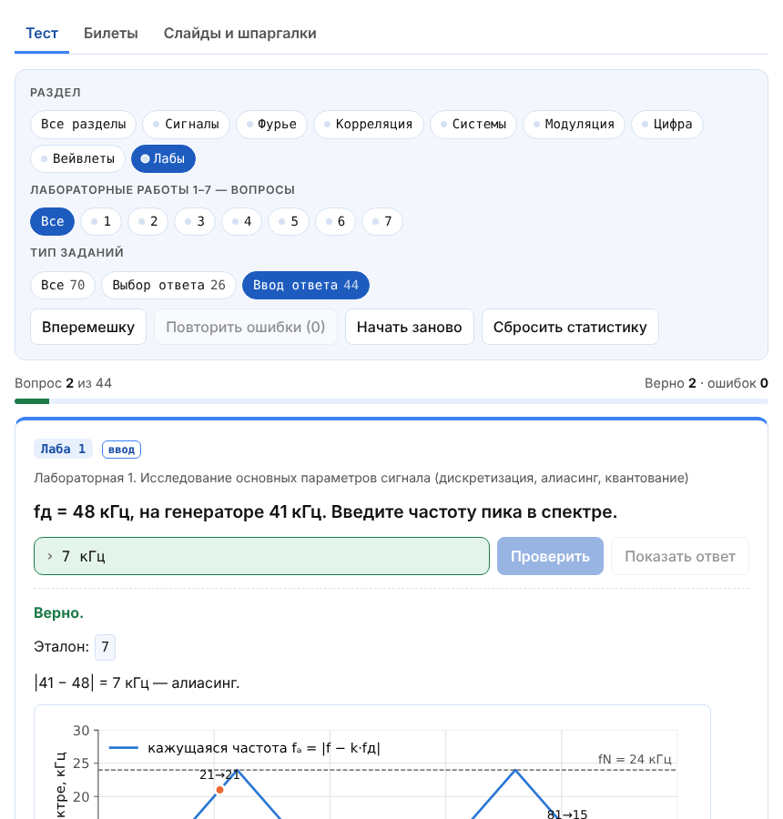

# ЦОС: тренажёр и билеты

Тренажёр к экзамену и защите лаб по «Цифровой обработке сигналов» (СФУ, ИКИТ). Около 470 вопросов по 40 вопросам к экзамену и 7 лабам. Часть заданий с вводом ответа: число, вызов функции MATLAB или вектор. Ещё есть билеты с развёрнутыми ответами, шпаргалки и слайды из лекций.

Сайт: https://ktoblyachtoblyayablya.github.io/dsp-trainer/



Числа в лабах посчитаны для варианта 12. У вас они будут другими, но порядок действий тот же.

## Что внутри

- Тест по разделам или по отдельному вопросу к экзамену. После ответа показываются пояснение, слайд или график и шпаргалка.
- Задания с вводом. Число можно писать с запятой, дробью (`1/16`) или с единицами (`24 кГц`), допуск 0,5 %. В командах MATLAB регистр важен.
- Билеты: ответ на каждый вопрос к экзамену и разбор каждой лабы — что делать в MATLAB/Simulink и что спросят на защите.
- Все билеты одной страницей (`#all`) и версия для печати (`#print`).
- Повтор ошибок, светлая и тёмная тема. Прогресс хранится в браузере, сервер не нужен.

## Запуск

Открыть `index.html` в браузере или поднять сервер: `python3 -m http.server 8000`.

## Как добавить вопрос

Вопросы лежат в `data/questions/*.js`, билеты — в `data/answers/*.js`, шпаргалки — в `data/cards.js`. Один вопрос — один объект:

```js
{t:"dft-8", q:"Уровень первого бокового лепестка окна Хэмминга?",
 o:["−43 дБ","−13 дБ","−31 дБ","−58 дБ"],
 e:"Главный лепесток вдвое шире, чем у прямоугольного окна.",
 c:"windows"}
```

`t` — тема (номер вопроса к экзамену или лаба), `q` — вопрос, `o` — варианты (первый правильный, на странице они перемешиваются), `e` — пояснение. В заданиях с вводом вместо `o` пишется `a` — список принимаемых ответов. Необязательные поля: `h` — подсказка в поле ввода, `ci: 1` — без учёта регистра, `f` — картинка, `fb: 1` — показать картинку сразу, `c` — шпаргалка.

После правок запустите `node tools/validate.js` (нужен Node.js 18+). Та же проверка идёт в GitHub Actions при каждом пуше.

## Слайды

Слайды в `img/slides` взяты из лекций курса. Права на них у авторов, под GPL они не попадают. Графики в `img/svg` сделаны для проекта, исходник — `tools/draw_src/plots.py`.

## Лицензия

Copyright (C) 2026 Пантелеев Г.Д. Код, вопросы, билеты и графики распространяются под [GPL-3.0-or-later](LICENSE).
